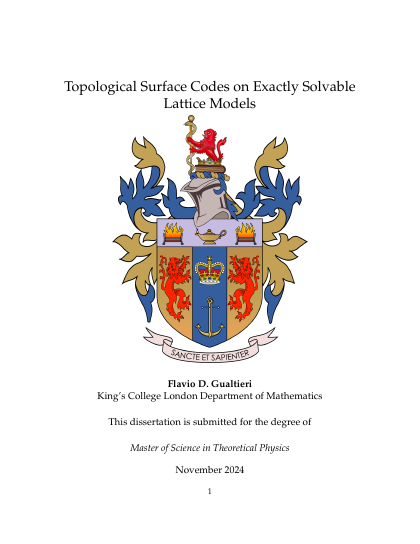
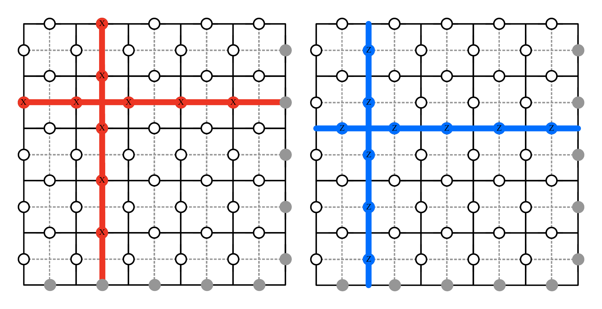
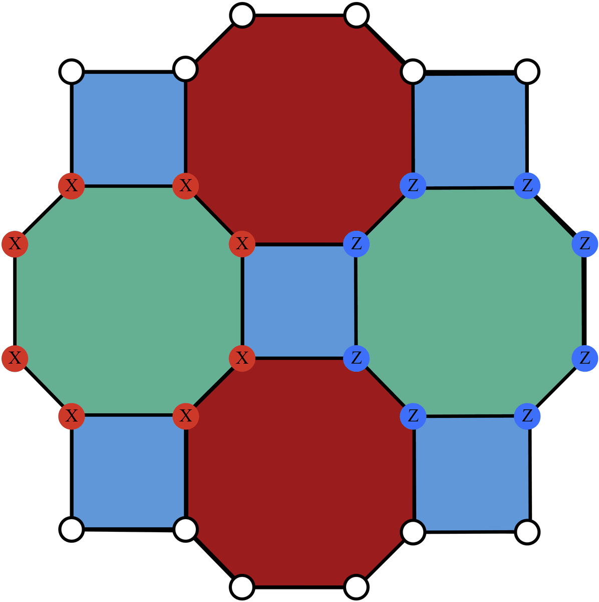

# Topological Surface Codes on Exactly Solvable Lattice Models

**Flavio D. Gualtieri** · MSc dissertation in Theoretical Physics · Department of Mathematics, King's College London · November 2024

**[Read online](https://flavio-gualtieri.github.io/Topological-Surface-Codes-on-Exactly-Solvable-Lattice-Models/)** · **[Download PDF](Gualtieri_MS_Thesis.pdf)** · [LaTeX source](main.tex)

<a href="https://flavio-gualtieri.github.io/Topological-Surface-Codes-on-Exactly-Solvable-Lattice-Models/"></a>

<!-- DRAFT: author to review -->
Topological codes protect quantum information from local noise by storing it in global, topological degrees of freedom of a lattice model. This dissertation studies two exactly solvable examples, the toric code and the color code, focusing on constructing logical operators and implementing fault-tolerant transversal gates. It develops the two-dimensional toric code: its stabilizer formalism and Hamiltonian, its four-fold degenerate ground state, its logical operators, and the fusion and braiding of its anyonic excitations, including boundaries and punctures. It then turns to color codes, which a local unitary transformation maps to decoupled copies of the toric code (two in two dimensions, three in three), and constructs transversal Hadamard, phase and C<sup>⊗d−1</sup>Z gates that reach beyond the Clifford group. An appendix introduces the algebraic topology used throughout.

<br clear="right">

## Figures



*The four classes of logical operators on the toric code (Figure 5). Left: X-type logical operators, with X̄<sub>1</sub> horizontal and X̄<sub>2</sub> vertical. Right: Z-type logical operators, with Z̄<sub>1</sub> vertical and Z̄<sub>2</sub> horizontal.*

<p align="center"></p>

*A two-dimensional color code (Figure 14). Every vertex is three-valent and the plaquettes are three-colorable; an X<sub>p</sub> stabilizer (red) and a Z<sub>p</sub> stabilizer (blue) each act on all vertices surrounding a plaquette.*

## Contents

| | Section | Page |
|---|---|--:|
| 1 | Introduction | 3 |
| 2 | Two Dimensional Toric Codes | 4 |
| 3 | Two-Dimensional Color Codes | 28 |
| 4 | Three-Dimensional Color Codes | 39 |
| 5 | Concluding Remarks | 49 |
| | References | 50 |
| 6 | Appendix: An Algebraic Topology Primer | 52 |

The [online version](https://flavio-gualtieri.github.io/Topological-Surface-Codes-on-Exactly-Solvable-Lattice-Models/) lists every subsection with a link to its page in the PDF.

## Citation

```bibtex
@mastersthesis{gualtieri2024topological,
  author  = {Gualtieri, Flavio D.},
  title   = {Topological Surface Codes on Exactly Solvable Lattice Models},
  school  = {Department of Mathematics, King's College London},
  type    = {{MSc} dissertation},
  address = {London, UK},
  year    = {2024},
  month   = nov,
  url     = {https://github.com/flavio-gualtieri/Topological-Surface-Codes-on-Exactly-Solvable-Lattice-Models}
}
```

The same metadata is in [`CITATION.cff`](CITATION.cff), which powers GitHub's *Cite this repository* button.

## Building

```sh
latexmk -pdf -jobname=Gualtieri_MS_Thesis main.tex
```

latexmk runs pdfLaTeX and BibTeX ([`references.bib`](references.bib)) as many times as needed; figures live in [`figures/`](figures/). On every push to `main` that touches the source, a GitHub Action recompiles the thesis and publishes it, together with [`site/index.html`](site/index.html), to the site above.

## License

The text and figures are licensed under [CC BY 4.0](LICENSE). The King's College London crest on the title page belongs to the university and is not covered by this license.
